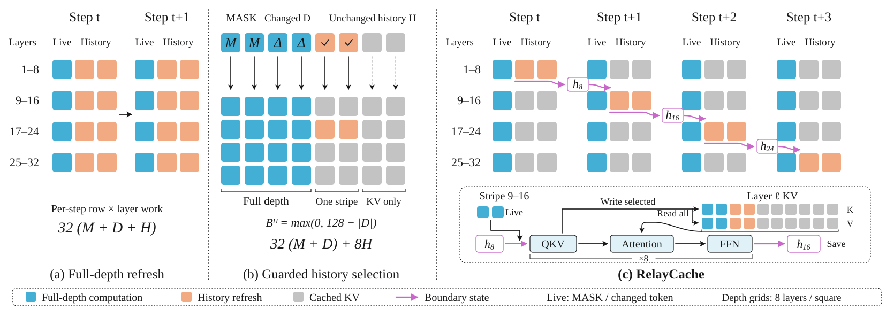

<div align="center">

# RelayCache

**Training-free acceleration of diffusion language models through cross-step context relay.**

[](https://github.com/Gerard-Devlin/Relay)
[](LICENSE)

</div>

## Highlights

- **Cross-step context relay.** Refresh selected history through a rotating layer stripe, and carry boundary hidden states into subsequent denoising steps.
- **Identity-aware history management.** Keep active prediction tokens and tokens whose identities changed on the full-depth path, while budgeting updates to unchanged history.
- **Language and vision support.** Separate integrations for LLaDA-8B-Instruct, DREAM-v0-Instruct-7B, and LLaDA-V, with generation and evaluation entry points for each model.

## Motivation & Method

<p align="center">
  
</p>

Diffusion decoding repeatedly revisits the same context. Even when only a subset of tokens is recomputed, refreshing every selected history row through the entire network remains expensive.

RelayCache distributes this history work across denoising steps. Selected unchanged history traverses a contiguous layer stripe; its boundary hidden state is saved so a later stripe can resume from it. Other layers reuse cached KV, and prediction tokens continue to read the context cache at every layer. Active and identity-changed tokens still execute the full network.

The released profiles use **8-layer stripes** and a **128-token history budget**. RelayCache is an approximate caching method and can change the decoding trajectory.

## Installation

Use Linux, an NVIDIA GPU, and the recorded Python 3.11 environment. If the evaluation dependencies are already installed:

```bash
git clone https://github.com/Gerard-Devlin/Relay.git
cd Relay
pip install -e . --no-deps
```

To install the recorded dependencies first:

```bash
pip install -r dllm-eval/configs/requirements-reproduction.txt \
  --extra-index-url https://download.pytorch.org/whl/cu128
pip install -e . --no-deps
```

### Supported models

| Model | Implementation | Reproduction profile |
|---|---|---|
| [LLaDA-8B-Instruct](https://huggingface.co/GSAI-ML/LLaDA-8B-Instruct) | [`relay_cache/llada/`](relay_cache/llada/) | [LLaDA](dllm-eval/configs/reproduction.json) |
| [DREAM-v0-Instruct-7B](https://huggingface.co/Dream-org/Dream-v0-Instruct-7B) | [`relay_cache/dream/`](relay_cache/dream/) | [DREAM](dllm-eval/configs/dream.json) |
| [LLaDA-V](https://huggingface.co/GSAI-ML/LLaDA-V) | [`relay_cache/lladav/`](relay_cache/lladav/) | [LLaDA-V](dllm-eval/configs/lladav.json) |

Fixed parameters and dependency versions are specified in these profiles and the [language](dllm-eval/configs/environment.json) / [vision](dllm-eval/configs/lladav_environment.json) environment records. Each model integration loads a pinned checkpoint revision; keep those snapshots in your Hugging Face hub cache. LLaDA-V also needs the SigLIP2 snapshot specified in its profile; the visual data command below can download both.

## Quickstart

Set an idle physical GPU index (or UUID) and your checkpoint cache:

```bash
export GPU=0
export HF_CACHE="$HOME/.cache/huggingface/hub"
```

**LLaDA**

```bash
python -m relay_cache --model llada --gpu "$GPU" --hf-hub-cache "$HF_CACHE" \
  --prompt 'What is 12 multiplied by 13?' --length 256 --output runs/llada.json
```

**DREAM**

```bash
python -m relay_cache --model dream --gpu "$GPU" --hf-hub-cache "$HF_CACHE" \
  --prompt 'What is 12 multiplied by 13?' --length 256 --output runs/dream.json
```

**LLaDA-V** — replace `example.png` with your image.

```bash
python -m relay_cache.lladav --gpu "$GPU" --hf-hub-cache "$HF_CACHE" \
  --image example.png --prompt 'Solve the problem in this image.' \
  --length 256 --output runs/lladav.json
```

## Evaluation

Evaluation code, fixed profiles, and saved results are organized under [`dllm-eval/`](dllm-eval/). The commands below evaluate both generation lengths, **256 and 512**.

### LLaDA and DREAM

Prepare the four benchmarks once:

```bash
python -m dllm_eval.prepare_gsm8k --output data/text/gsm8k_paper_5shot.json
python -m dllm_eval.prepare_tasks --task math --output data/text/math_paper_4shot_v2.json
python -m dllm_eval.prepare_humaneval --output data/text/humaneval_test.json
python -m dllm_eval.prepare_tasks --task mbpp --output data/text/mbpp_paper_3shot.json
```

**LLaDA**

```bash
python -m dllm_eval.run --model llada --data-root data/text \
  --hf-hub-cache "$HF_CACHE" --gpu "$GPU" --output runs/llada
```

**DREAM**

```bash
python -m dllm_eval.run --model dream --data-root data/text \
  --hf-hub-cache "$HF_CACHE" --gpu "$GPU" --output runs/dream
```

The text suite uses GSM8K **5-shot**, MATH **4-shot**, HumanEval **0-shot**, and MBPP **3-shot**. Scoring uses GSM8K answer matching, `final-expression-v3` with Math-Verify 0.1.0 for MATH, and execution-based checks for code tasks.

### LLaDA-V

Prepare MathVista and MathVerse, then generate:

```bash
python -m dllm_eval.visual_data --download --hf-hub-cache "$HF_CACHE" --output data/visual
python -m dllm_eval.visual_run --data-root data/visual --hf-hub-cache "$HF_CACHE" \
  --gpu "$GPU" --output runs/lladav
```

Omit `--download` when the pinned snapshots are already cached. The visual suite uses MathVista `testmini` (1,000 questions) and the three visual MathVerse `testmini` variants (2,364 questions), both zero-shot.

Score the saved outputs separately, with `DEEPSEEK_API_KEY` set in your environment:

```bash
python -m dllm_eval.visual_score --run runs/lladav --data-root data/visual \
  --output runs/lladav_scores
```

Visual scores use **DeepSeek Flash** for extraction/judging with MathVista normalization and MathVerse evaluation prompts. This is a proxy evaluation, not the official GPT-4o score. Saved outputs can be rescored without rerunning the model.

Evaluation workers warm up on two requests at startup, then generate once per formal question. Logs with block progress bars are saved under `log/`. Use `--resume` to continue a matching run; `--help` lists task, length, and shard options.

## Acknowledgments

We thank the authors of [LLaDA](https://github.com/ML-GSAI/LLaDA), [DREAM](https://github.com/DreamLM/Dream), [LLaDA-V](https://github.com/ML-GSAI/LLaDA-V), [LLaVA](https://github.com/haotian-liu/LLaVA), [Flash-dLLM](https://github.com/VILA-Lab/Flash-dLLM), [Fast-dLLM](https://github.com/NVlabs/Fast-dLLM), [Transformers](https://github.com/huggingface/transformers), [Math-Verify](https://github.com/huggingface/Math-Verify), [MathVista](https://github.com/lupantech/MathVista), and [MathVerse](https://github.com/ZrrSkywalker/MathVerse) for their open-source work.

Adapted components retain their attribution. See [NOTICE](NOTICE) and [LICENSE](LICENSE).
